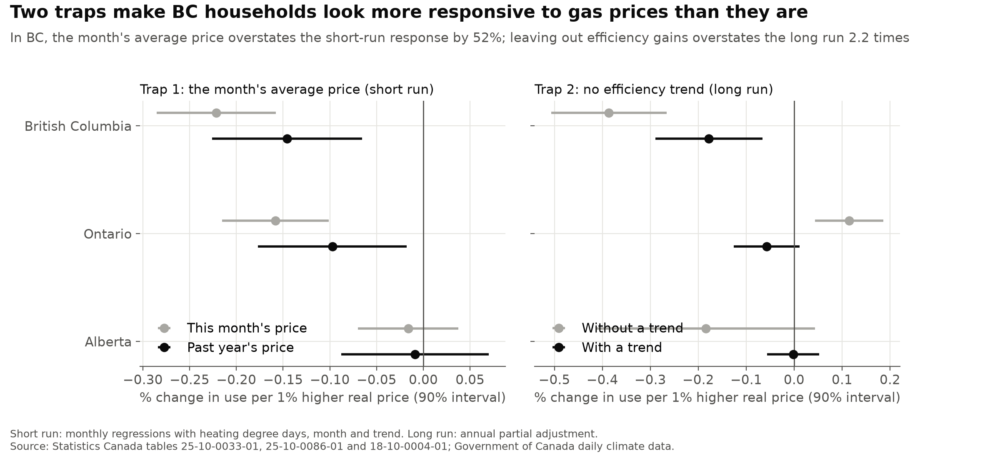
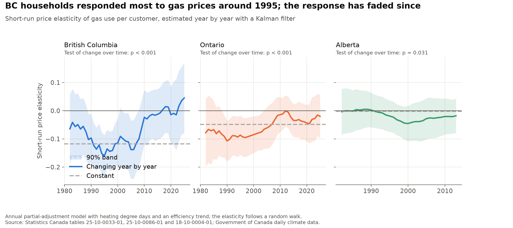
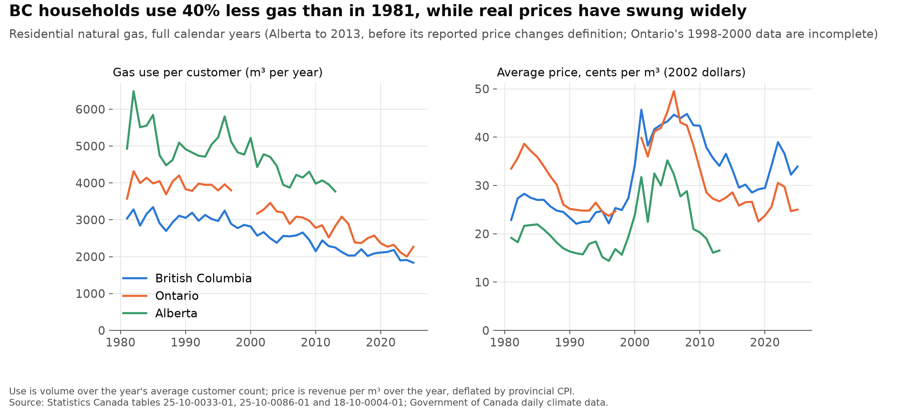

# canada_gas_demand

[](https://github.com/atamalfuzi/canada_gas_demand/actions/workflows/tests.yml)

An independent look at how households in British Columbia, Ontario and Alberta respond to the price of natural gas, built from public data in Python. It asks three questions: how much does a higher price reduce gas use, how does that differ between the first year and the long run, and has the response changed since 1980? Along the way it shows two traps that make households look more price-sensitive than they are.

> **Personal project.** This is my own analysis of publicly available data. It is not associated with my work for any current or past employer and does not represent their views.







## What it shows

A price elasticity of −0.1 means a 10% higher real price cuts gas use per customer by 1%.

| | British Columbia | Ontario | Alberta (1981–2013) |
|---|---|---|---|
| Short run, first year | **−0.12** (SE 0.04) | −0.05 (0.04) | 0.00 (0.03) |
| Long run, after adjustment | **−0.18** (0.07) | −0.06 (0.04) | 0.00 (0.03) |
| Monthly, past year's price | −0.15 (0.05) | −0.10 (0.05) | −0.01 (0.05) |
| *Trap 1: the month's average price* | *−0.22 (52% too large)* | *−0.16 (63% too large)* | *−0.02* |
| *Trap 2: long run without an efficiency trend* | *−0.39 (2.2 times too large)* | *+0.12 (wrong sign)* | *−0.18* |

- **Households respond only a little to gas prices.** In BC, a 10% higher real price cuts gas use by about 1.2% within the year and 1.8% once households have adjusted. Ontario's response is smaller, and Alberta's, with cheap gas and cold winters, is indistinguishable from zero.
- **Trap 1: the month's average price.** The only price in the data is revenue per cubic metre, which includes fixed monthly charges. In a cold month the fixed charge is spread over more gas, so the average price falls just as use rises, and a regression reads the weather as a price response. Using the average price over the previous 12 months, which households have actually seen on their bills, removes this: the month's average price overstates the response by 52% in BC and 63% in Ontario.
- **Trap 2: leaving out efficiency gains.** Gas use per customer fell 40% in BC from 1981 to 2025, 37% in Ontario and 24% in Alberta by 2013, about 7–10% a decade from better furnaces, insulation and smaller homes. Prices rose over much of that time, so a model without a trend credits the price for the efficiency gains: BC's long-run response looks 2.2 times too large, and Ontario's even comes out with the wrong sign.
- **The response has faded since about 2010.** Estimated year by year, BC's short-run elasticity was strongest around 1995 (−0.16) and averaged −0.12 over 1990–2005, but has been close to zero since 2011. Ontario's moved from about −0.09 to −0.03. The change over time is statistically clear in BC and Ontario (likelihood-ratio test, p < 0.001) and weaker in Alberta (p = 0.03). The data cannot show why; one possibility is that after decades of efficiency gains, more of the gas that remains goes to basic space and water heating.

## Method

**Data preparation.** Monthly residential gas volume, revenue and customers come from two Statistics Canada tables, one ending in 2015 and one starting in 2016. Use per customer is volume over customers; the price is revenue per cubic metre, deflated by the provincial consumer price index. Heating degree days below 18 °C are summed from daily mean temperatures at Vancouver, Toronto and Calgary airports, joining each airport's old and new station records. Three problems in the tables are handled explicitly:

- From November 2014, Alberta's reported price covers only the gas commodity, about half of what households pay, so Alberta is analysed to October 2014 (full years to 2013).
- In 1998–2000, as Ontario's retail gas market opened, the table covers only part of the volume (down a quarter) and of the customers, and the customer count jumps a quarter in 2001. Those three years are left out, and Ontario gets a separate level from 2001.
- In 2016–2018 the newer table counts only part of Ontario's customers (2.0 million, against 3.3 million before and 3.4 million after) while volumes are complete; the counts are filled by a straight line between December 2015 and January 2019.

Every model also allows a separate level from 2016, when the table changes. The test for whether a period needs its own level came from the data: without the 2001 level, Ontario's monthly estimate is −0.16, but −0.04 using only 2001 onward and +0.06 using only 1981–1997, because the model read the jump across the data gap as a price response.

**1. Monthly price response.** A least-squares regression of log use per customer on a log real price, heating degree days, calendar month, a linear trend and the reporting levels, with standard errors robust to a year of autocorrelation. It is run with the month's own average price (trap 1) and with the average log price over the previous 12 months.

**2. Short and long run.** An annual partial-adjustment model: log use on the log real price, last year's log use, heating degree days, a linear trend and the reporting levels. Households close part of the gap to their long-run level each year, so the short-run elasticity is the price coefficient *b* and the long-run one *b* / (1 − the coefficient on last year's use), with a delta-method standard error. Prices are weighted by volume within each year. Dropping the trend shows trap 2.

**3. Change over time.** The same annual model as a state space, with the short-run elasticity following a random walk. The variances of the elasticity's year-to-year changes and of the noise are estimated by maximum likelihood, and the Kalman smoother traces the elasticity with a 90% band. Years with missing data stay in as missing observations, so the elasticity drifts across them. A likelihood-ratio test compares it with a constant elasticity; because the variance being tested sits on the boundary (zero), the p-value is half the chi-squared one.

All estimates are in [`output/elasticities.csv`](output/elasticities.csv), the year-by-year elasticities in [`output/elasticity_over_time.csv`](output/elasticity_over_time.csv) and the annual series in [`output/annual.csv`](output/annual.csv). The data handling and models are checked by the tests in [`tests/`](tests/test_gas.py), which run on every push, including the models recovering known elasticities from simulated data.

## Limits

- **Average, not marginal, price.** Revenue per cubic metre mixes the per-unit price with fixed charges. The past-year average avoids the seasonal trap, but it is still not the price of the next cubic metre.
- **The price includes taxes and charges in force at the time,** including carbon charges where they applied. This project estimates the response to the total price only. It does not evaluate any carbon pricing or other policy.
- **Customers, not households,** and aggregate data: the estimates are averages across very different homes, heating systems and incomes.
- **One airport per province** stands in for the weather where customers live.
- **Prices are not set by an experiment.** Residential gas rates are regulated and follow wholesale markets, so they respond little to one province's demand within a year, but the estimates are associations under the model's assumptions, not proof of cause.
- **Short samples and a model choice.** The annual models have 32–44 years. How much the elasticity appears to change over time depends on including the efficiency trend: without it, the elasticity drifts to implausible positive values after 2010.

## Data

The script downloads everything itself:

| Data | Source | Licence |
|---|---|---|
| Monthly residential natural gas sales, revenue and customers, 1980–2015 | Statistics Canada, [table 25-10-0033-01](https://www150.statcan.gc.ca/t1/tbl1/en/tv.action?pid=2510003301) | [Statistics Canada Open Licence](https://www.statcan.gc.ca/en/terms-conditions/open-licence) |
| Monthly residential natural gas consumption, sales and customers, 2016 onward | Statistics Canada, [table 25-10-0086-01](https://www150.statcan.gc.ca/t1/tbl1/en/tv.action?pid=2510008601) | Statistics Canada Open Licence |
| Consumer price index by province, monthly | Statistics Canada, [table 18-10-0004-01](https://www150.statcan.gc.ca/t1/tbl1/en/tv.action?pid=1810000401) | Statistics Canada Open Licence |
| Daily mean temperature at Vancouver, Toronto and Calgary airports | Government of Canada historical climate data, via the [MSC GeoMet API](https://api.weather.gc.ca/collections/climate-daily) | [Open Government Licence – Canada](https://open.canada.ca/en/open-government-licence-canada) |

Adapted from Statistics Canada, tables 25-10-0033-01, 25-10-0086-01 and 18-10-0004-01. This does not constitute an endorsement by Statistics Canada of this product. Contains information licensed under the Open Government Licence – Canada.

## Run it

Python 3.12:

```
python -m venv .venv
.venv\Scripts\activate          # Windows; on macOS or Linux: source .venv/bin/activate
pip install -r requirements.txt
python gas.py
```

Run it from the repository folder. The first run downloads about 21 MB into `data/`; later runs reuse those files (delete them to download again) and take a few seconds. It writes the charts to `figures/` and the tables to `output/`, and prints the estimates.

To run the tests: `pip install -r requirements-dev.txt`, then `pytest`. They need no downloads.

## License

Code: [MIT](LICENSE).
