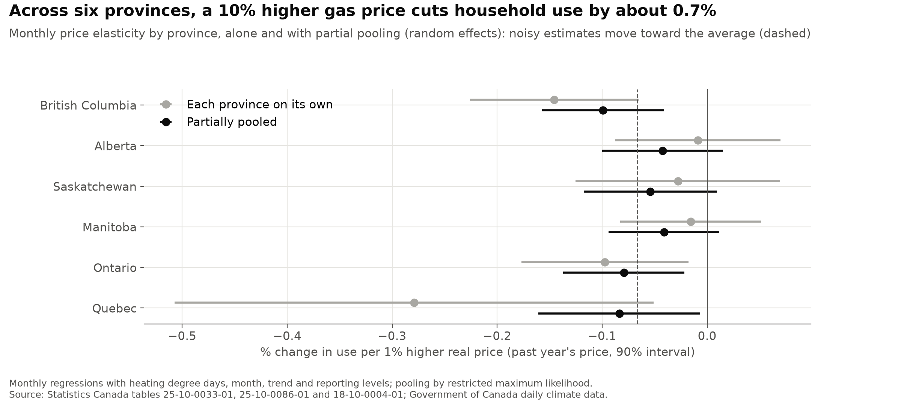
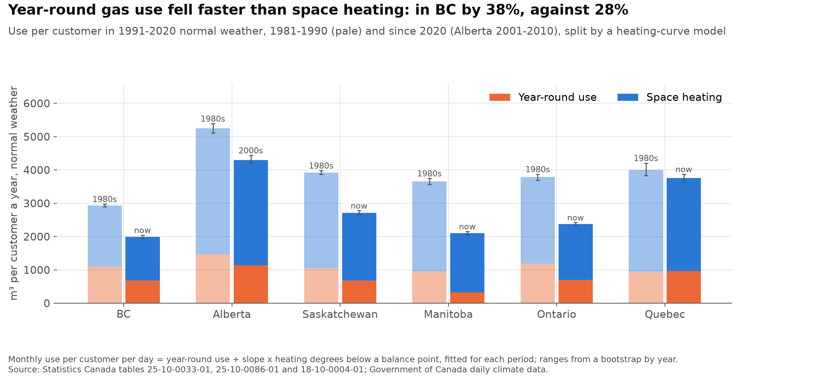
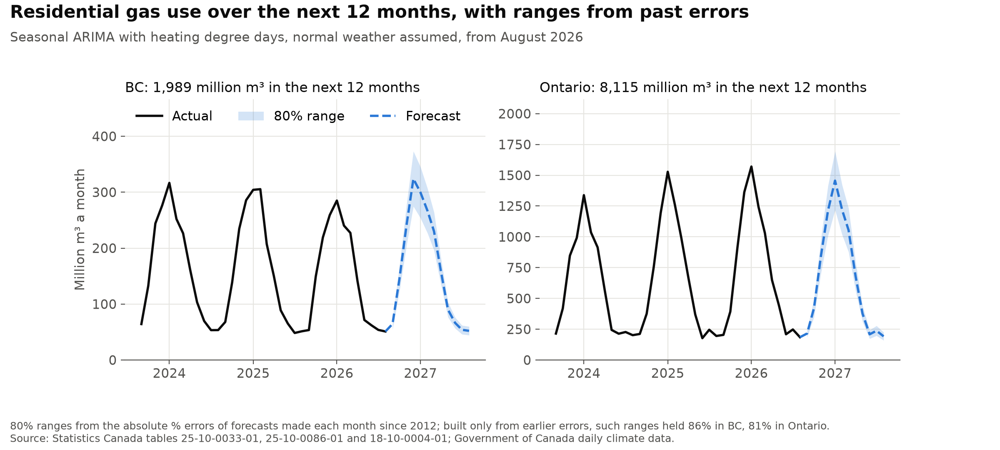
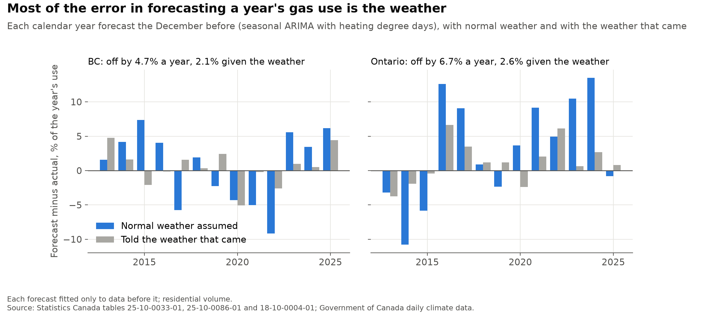
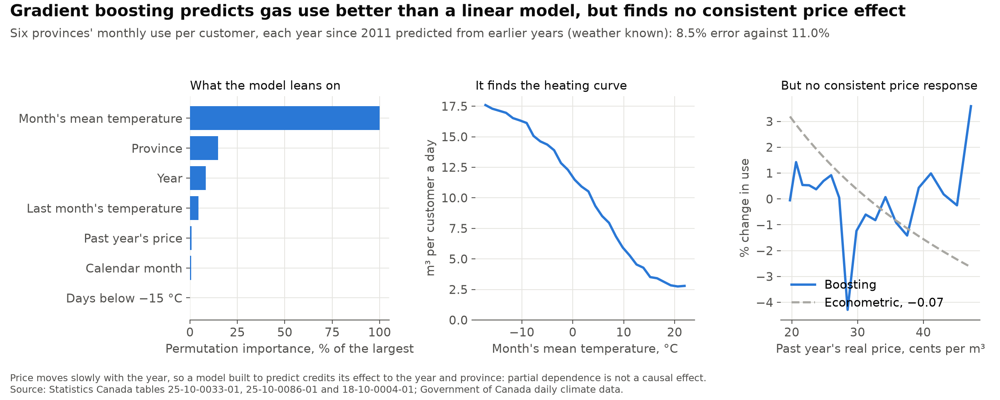

# canada_gas_demand

[](https://github.com/atamalfuzi/canada_gas_demand/actions/workflows/tests.yml)

Five questions about household natural gas in Canada since 1981, each answered with public data and a method suited to it, from regressions and partial pooling to heating-curve models, calibrated forecasts and machine learning. Python, with pandas, statsmodels and scikit-learn. The price response is measured in British Columbia, Ontario and Alberta; the other questions add Saskatchewan, Manitoba and Quebec.

**[Live dashboard](https://atamalfuzi.github.io/canada_gas_demand/)**, rebuilt on the 28th of each month from Statistics Canada's latest data: the latest month's gas use in BC and Ontario against what weather, season, price and trend predict, the last 12 months against the 12 before, the real price, a 12-month forecast with an 80% range, and the elasticities re-estimated with all data to date. **[Write-up with interactive charts](https://atamalfuzi.github.io/canada-gas-demand.html).** The results below are as of October 2026 (data through August 2026).

> **Personal project.** This is my own analysis of publicly available data. It is not associated with my work for any current or past employer and does not represent their views.

| Question | Methods | Answer |
|---|---|---|
| [How much do households respond to price?](#1-how-much-do-households-respond-to-price) | Regression, partial adjustment, Kalman filter | A little: in BC a 10% higher price cuts use 1.2% within the year and 1.8% in the long run; two traps overstate it |
| [Is BC different from other provinces?](#2-is-bc-different-from-other-provinces) | Random effects (partial pooling), recursive bootstrap | Across six provinces the response averages −0.07; BC's −0.15 moves to −0.10 once its noise is allowed for |
| [Where did the fall in use come from?](#3-where-did-the-fall-in-use-come-from) | Heating-curve (balance-point) regression, bootstrap, segmented trends | In BC, 45% of it from year-round use such as water heating, which fell 38% against 28% for space heating; the decline began in 2000 |
| [How well can demand be forecast?](#4-how-well-can-demand-be-forecast) | Seasonal ARIMA, exponential smoothing, conformal prediction | A year ahead to within 4.7% in BC and 6.7% in Ontario; given the weather, 2.1% and 2.6% |
| [What does machine learning see?](#5-what-does-machine-learning-see) | Gradient boosting, permutation importance, partial dependence | Better predictions than a linear model and the heating curve, but no consistent price effect |

## What it shows

### 1. How much do households respond to price?


A price elasticity of −0.1 means a 10% higher real price cuts gas use per customer by 1%.

| | British Columbia | Ontario | Alberta (1981–2013) |
|---|---|---|---|
| Short run, first year | **−0.12** (SE 0.04) | −0.05 (0.04) | 0.00 (0.03) |
| Long run, after adjustment | **−0.18** (0.07) | −0.06 (0.04) | 0.00 (0.03) |
| Monthly, past year's price | −0.15 (0.05) | −0.10 (0.05) | −0.01 (0.05) |
| *Trap 1: the month's average price* | *−0.22 (52% too large)* | *−0.16 (63% too large)* | *−0.02* |
| *Trap 2: long run without an efficiency trend* | *−0.39 (2.2 times too large)* | *+0.12 (wrong sign)* | *−0.18* |

- **Households respond only a little to gas prices.** In BC, a 10% higher real price cuts gas use by about 1.2% within the year and 1.8% once households have adjusted. Ontario's response is smaller, and Alberta's, with cheap gas and cold winters, is indistinguishable from zero.
- **Trap 1: the month's average price.** The only price in the data is revenue per cubic metre, which includes fixed monthly charges. In a cold month the fixed charge is spread over more gas, so the average price falls just as use rises, and a regression reads the weather as a price response. Using the average price over the previous 12 months, which households have actually seen on their bills, removes this: the month's average price overstates the response by 52% in BC and 63% in Ontario.
- **Trap 2: leaving out efficiency gains.** Gas use per customer fell 40% in BC from 1981 to 2025, 37% in Ontario and 24% in Alberta by 2013, about 7–10% a decade from better furnaces, insulation and smaller homes. Prices rose over much of that time, so a model without a trend credits the price for the efficiency gains: BC's long-run response looks 2.2 times too large, and Ontario's even comes out with the wrong sign.
- **The response has faded since about 2010.** Estimated year by year, BC's short-run elasticity was strongest around 1995 (−0.16) and averaged −0.12 over 1990–2005, but has been close to zero since 2011. Ontario's moved from about −0.09 to −0.03. The change over time is statistically clear in BC and Ontario (likelihood-ratio test, p < 0.001) and weaker in Alberta (p = 0.03). The data cannot show why; one possibility is that after decades of efficiency gains, more of the gas that remains goes to basic space and water heating.

### 2. Is BC different from other provinces?



- **The average response across six provinces is small, and BC's is at the high end.** The same monthly model (past year's price, heating degree days, month, trend and reporting levels) gives elasticities from −0.01 in Alberta to −0.28 in Quebec, with standard errors from 0.04 to 0.14. A random-effects model, fitted by restricted maximum likelihood, puts the average at −0.067 (SE 0.028) and the real spread between provinces at a standard deviation of 0.04. Each province's estimate moves toward the average by as much as its own noise warrants: BC's −0.15 becomes −0.10, still the largest, and Quebec's −0.28, the noisiest, becomes −0.08. The annual short-run elasticities pool to −0.04 (SE 0.02).
- **A bootstrap checks the long-run ranges.** Rebuilding each province's annual series year by year from the model and resampled residuals, and refitting 1,000 times, gives a 90% range for BC's long-run elasticity of −0.28 to −0.07, close to the delta method's −0.29 to −0.07. For Quebec, where use adjusts slowly, it is narrower: −0.95 to −0.15, against −1.08 to −0.05.

### 3. Where did the fall in use come from?



- **Each month's gas use traces a heating curve.** Use per customer per day is a floor of year-round use (water heating, cooking, dryers) plus heating that rises with each degree below a balance point, about 14–15 °C in BC and Ontario. Fitted for each decade, it explains 89–99% of the monthly variation in five provinces and 82–93% in Quebec.
- **Year-round use fell faster than heating.** In 1991–2020 normal weather, BC's use per customer fell from 2,939 m³ a year in 1981–1990 to 1,996 since 2020 (90% range 1,939–2,047), down 32%. Year-round use fell 38% (1,101 to 679 m³) and space heating 28% (1,838 to 1,317), so year-round use, about a third of the total, accounts for 45% of the fall. In Ontario year-round use fell 41% and heating 35%; in Manitoba year-round use fell by two thirds. The ranges come from refitting each period to whole years drawn with replacement.
- **The decline began in 2000 in BC and the early 1990s in Ontario and Saskatchewan.** Split into straight-line segments, BC's weather-normalised use per customer is flat to 1999 and falls 1.4% a year from 2000 (90% range for the start: 1999–2000). Ontario's decline starts in 1992 (1988–1996), at 1.7% a year; Saskatchewan's in 1991 (1990–1996), slowing from 2015. Manitoba's has fallen 1.5% a year since 1981 and Alberta's 1.1% a year to 2013, with no break.

### 4. How well can demand be forecast?





- **A year's gas use can be forecast to within about 5% in BC and 7% in Ontario, and most of the error is the weather.** From every month since December 2012, a seasonal ARIMA with heating degree days, fitted only to the data before it and assuming normal weather ahead, forecast the next 12 months of residential volume. Forecasting each calendar year the December before, it missed by 4.7% on average in BC and 6.7% in Ontario. Told the weather that came, the same model missed by 2.1% and 2.6%.
- **Month by month it misses by about 9% in BC and 9–12% in Ontario.** In BC it beats exponential smoothing and the same month last year at every horizon; in Ontario it beats exponential smoothing and is level with the same month last year beyond a month. For a year's total in BC, repeating last year did as well (4.5%): the model's value is the monthly shape, the ranges and the split into weather and the rest.

| Average error, % of volume | 1 month ahead | 3 months | 12 months |
|---|---|---|---|
| BC: seasonal ARIMA with weather | 9.2 | 8.9 | 8.9 |
| BC: exponential smoothing | 9.5 | 9.7 | 10.0 |
| BC: same month last year | 11.7 | 11.7 | 11.6 |
| *BC: ARIMA told the weather* | *6.7* | *6.7* | *6.6* |
| Ontario: seasonal ARIMA with weather | 9.0 | 11.6 | 11.7 |
| Ontario: exponential smoothing | 11.3 | 16.1 | 11.7 |
| Ontario: same month last year | 11.6 | 11.7 | 11.6 |
| *Ontario: ARIMA told the weather* | *7.5* | *8.5* | *8.3* |

- **Ranges from past errors hold as often as stated; the model's own do not in Ontario.** Ranges set from the model's absolute % errors at each horizon (conformal prediction), built at each point only from errors already known, held 86% of outcomes in BC and 81% in Ontario at a stated 80%. The model's own 80% ranges held 82% and 62%. From August 2026, the forecast for September 2026 to August 2027 is 1,989 million m³ in BC (80% range 1,858–2,120) and 8,115 million m³ in Ontario (7,174–9,057).

### 5. What does machine learning see?



- **Gradient boosting predicts better than a linear model.** On 3,104 province-months in six provinces, gradient-boosted trees on the month's and last month's temperature, days below −15 °C, calendar month, year, the past year's price and the province predict each year from 2011 to August 2026, trained only on earlier years with the weather known, with an average error of 8.5%, against 11.0% for a linear model of each province with heating degree days, month, trend, price and reporting levels.
- **It finds the heating curve.** Permutation importance puts the month's temperature far ahead of everything else, and partial dependence on it traces the heating curve, flattening in the coldest months.
- **It finds no consistent price effect, and that is the lesson.** Partial dependence on the past year's price wobbles with no trend (slope +0.003, against −0.07 from the pooled econometric estimate), and price ranks fifth in importance. Price moves slowly with the year and differs by province, so a model built to predict credits its effect to those. Predicting use and estimating the response to price are different jobs: the price response comes from the econometric models, which separate price from trend and weather by design.

## Method

**Data preparation.** Monthly residential gas volume, revenue and customers come from two Statistics Canada tables, one ending in 2015 and one starting in 2016. Use per customer is volume over customers; the price is revenue per cubic metre, deflated by the provincial consumer price index. Heating degree days below 18 °C are summed from daily mean temperatures at Vancouver, Calgary, Regina, Winnipeg, Toronto and Montreal airports, joining each airport's old and new station records. Three problems in the tables are handled explicitly:

- From November 2014, Alberta's reported price covers only the gas commodity, about half of what households pay, so Alberta is analysed to October 2014 (full years to 2013).
- In 1998–2000, as Ontario's retail gas market opened, the table covers only part of the volume (down a quarter) and of the customers, and the customer count jumps a quarter in 2001. Those three years are left out, and Ontario gets a separate level from 2001.
- In 2016–2018 the newer table counts only part of Ontario's customers (2.0 million, against 3.3 million before and 3.4 million after) while volumes are complete; the counts are filled by a straight line between December 2015 and January 2019.

Every model also allows a separate level from 2016, when the table changes. The test for whether a period needs its own level came from the data: without the 2001 level, Ontario's monthly estimate is −0.16, but −0.04 using only 2001 onward and +0.06 using only 1981–1997, because the model read the jump across the data gap as a price response. The same test sets the levels for the three added provinces: Manitoba gets one from 2007, when the older table splits utility and direct sales and Manitoba's customer count rises 5% while use per customer falls 6% against the weather (t = −3.0); a level from 2001, where its count starts falling, is not needed (t = 0.9). Quebec gets one from 2019, when its customer count jumps a quarter after three years frozen at one figure (t = −6.1).

**1. Monthly price response.** A least-squares regression of log use per customer on a log real price, heating degree days, calendar month, a linear trend and the reporting levels, with standard errors robust to a year of autocorrelation. It is run with the month's own average price (trap 1) and with the average log price over the previous 12 months.

**2. Short and long run.** An annual partial-adjustment model: log use on the log real price, last year's log use, heating degree days, a linear trend and the reporting levels. Households close part of the gap to their long-run level each year, so the short-run elasticity is the price coefficient *b* and the long-run one *b* / (1 − the coefficient on last year's use), with a delta-method standard error. Prices are weighted by volume within each year. Dropping the trend shows trap 2.

**3. Change over time.** The same annual model as a state space, with the short-run elasticity following a random walk. The variances of the elasticity's year-to-year changes and of the noise are estimated by maximum likelihood, and the Kalman smoother traces the elasticity with a 90% band. Years with missing data stay in as missing observations, so the elasticity drifts across them. A likelihood-ratio test compares it with a constant elasticity; because the variance being tested sits on the boundary (zero), the p-value is half the chi-squared one.

**4. Partial pooling.** Each province's monthly elasticity (past year's price) and annual short-run elasticity are treated as the average plus a province effect plus noise with its known standard error. The variance of the province effects is estimated by restricted maximum likelihood, and each province's pooled estimate weights its own against the average by the two variances (empirical Bayes). The long-run elasticity's 90% range comes from a recursive residual bootstrap: 1,000 times, log use is rebuilt year by year from the fitted annual model, its own simulated past and resampled residuals, and the model refitted.

**5. Heating curves and trends.** For each decade, use per customer per day = year-round use + slope × the month's mean heating degrees per day below a balance point, with the balance point (10–22 °C, in half degrees) chosen by least squares. Normal-weather annual use is 365.25 × year-round use + slope × the heating degrees below that balance point in an average 1991–2020 year. 90% ranges come from 200 refits to whole years drawn with replacement. The segmented trend splits each province's annual log use per customer, adjusted to normal weather with the monthly model, into straight lines with their own levels and slopes, at least six years each, fitted exactly by dynamic programming. The number of breaks is chosen by the LWZ criterion (Liu, Wu and Zidek), a Schwarz criterion with a heavier penalty: in simulated straight lines BIC found breaks 8.5% of the time, LWZ never. Ranges for the break years come from 500 residual-bootstrap refits with the number of breaks held fixed.

**6. Forecasts.** Residential volume in BC (from 1990) and Ontario (from 2001), in logs, from a seasonal ARIMA(1,0,1)(0,1,1)₁₂ with this month's and last month's heating degree days (bills lag the weather), exponential smoothing with a damped trend, and the same month last year. From each month since December 2012, each is fitted only to the data up to then and forecasts 12 months, with each month's heating degree days ahead set to its average over the previous 30 years; the ARIMA is run again with the heating degree days that came. Errors are absolute % errors weighted by volume. Conformal ranges: at each horizon, the 80th percentile of the absolute % errors of earlier forecasts whose outcomes were known at the time (once there are 24). The range for the next 12 months' total comes from the errors of all earlier 12-month totals.

**7. Machine learning.** scikit-learn's histogram gradient boosting (400 trees, learning rate 0.05, the province as a categorical feature) on log use per customer per day, tested year by year from 2011 with an expanding window. Permutation importance (10 repeats) and partial dependence (averaged over all province-months) come from the model fitted to all years.

All estimates are in [`output/`](output): the price responses in [`elasticities.csv`](output/elasticities.csv), [`elasticity_over_time.csv`](output/elasticity_over_time.csv), [`provinces.csv`](output/provinces.csv) and [`provinces_pooled.csv`](output/provinces_pooled.csv); the heating curves and trends in [`heating_curves.csv`](output/heating_curves.csv) and [`trend_segments.csv`](output/trend_segments.csv); the forecasts and their errors in [`forecast.csv`](output/forecast.csv), [`forecast_total.csv`](output/forecast_total.csv), [`forecast_errors.csv`](output/forecast_errors.csv), [`forecast_years.csv`](output/forecast_years.csv) and [`forecast_coverage.csv`](output/forecast_coverage.csv); the machine-learning results in [`boosting_errors.csv`](output/boosting_errors.csv) and [`boosting_importance.csv`](output/boosting_importance.csv); the annual series in [`annual.csv`](output/annual.csv); and the data for the write-up's interactive charts in `gas-data.js`. The data handling and models are checked by the tests in [`tests/`](tests), which run on every push, including the models recovering known elasticities, a known heating curve, a known average and spread, and a planted trend break from simulated data, and conformal ranges built only from errors known at the time.

## Limits

- **Average, not marginal, price.** Revenue per cubic metre mixes the per-unit price with fixed charges. The past-year average avoids the seasonal trap, but it is still not the price of the next cubic metre.
- **The price includes taxes and charges in force at the time,** including carbon charges where they applied. This project estimates the response to the total price only. It does not evaluate any carbon pricing or other policy.
- **Customers, not households,** and aggregate data: the estimates are averages across very different homes, heating systems and incomes.
- **One airport per province** stands in for the weather where customers live.
- **The added provinces' reporting levels are inferred.** Manitoba's 2007 and Quebec's 2019 levels come from jumps in the data tested in the model, not from documentation of how the tables changed, and the six-province results depend on them.
- **Year-round use is whatever does not follow the temperature.** Besides more efficient water heaters and appliances, a changing mix of customers, such as smaller new homes or apartment buildings counted as one customer, moves it. Quebec's heating curves fit least well.
- **Forecasts assume normal weather,** which is most of their error, and partial dependence shows what a model learned from the data, not what would happen if one input changed alone.
- **Prices are not set by an experiment.** Residential gas rates are regulated and follow wholesale markets, so they respond little to one province's demand within a year, but the estimates are associations under the model's assumptions, not proof of cause.
- **Short samples and a model choice.** The annual models have 32–44 years. How much the elasticity appears to change over time depends on including the efficiency trend: without it, the elasticity drifts to implausible positive values after 2010.

## Data

The script downloads everything itself:

| Data | Source | Licence |
|---|---|---|
| Monthly residential natural gas sales, revenue and customers, 1980–2015 | Statistics Canada, [table 25-10-0033-01](https://www150.statcan.gc.ca/t1/tbl1/en/tv.action?pid=2510003301) | [Statistics Canada Open Licence](https://www.statcan.gc.ca/en/terms-conditions/open-licence) |
| Monthly residential natural gas consumption, sales and customers, 2016 onward | Statistics Canada, [table 25-10-0086-01](https://www150.statcan.gc.ca/t1/tbl1/en/tv.action?pid=2510008601) | Statistics Canada Open Licence |
| Consumer price index by province, monthly | Statistics Canada, [table 18-10-0004-01](https://www150.statcan.gc.ca/t1/tbl1/en/tv.action?pid=1810000401) | Statistics Canada Open Licence |
| Daily mean temperature at Vancouver, Calgary, Regina, Winnipeg, Toronto and Montreal airports | Government of Canada historical climate data, via the [MSC GeoMet API](https://api.weather.gc.ca/collections/climate-daily) | [Open Government Licence – Canada](https://open.canada.ca/en/open-government-licence-canada) |

Adapted from Statistics Canada, tables 25-10-0033-01, 25-10-0086-01 and 18-10-0004-01. This does not constitute an endorsement by Statistics Canada of this product. Contains information licensed under the Open Government Licence – Canada.

## Run it

Python 3.12:

```
python -m venv .venv
.venv\Scripts\activate          # Windows; on macOS or Linux: source .venv/bin/activate
pip install -r requirements.txt
python gas.py
python provinces.py
python heating.py
python forecast.py
```

Run them from the repository folder, in this order (`heating.py` uses the pooled elasticity from `provinces.py`). The first run downloads about 25 MB into `data/`; later runs reuse those files (delete them to download again). `gas.py` takes a few seconds and `provinces.py` and `heating.py` under a minute each; `forecast.py` refits the forecast models from 164 months and takes about five minutes. They write the charts to `figures/` and the tables to `output/`, and print the estimates.

To run the tests: `pip install -r requirements-dev.txt`, then `pytest`. They need no downloads.

To build the dashboard, run `python dashboard.py` after the four scripts. It writes a static site to `site/` and stops without writing if the latest data have gaps or implausible values. Delete `data/` first to pick up Statistics Canada's newest month. The [dashboard workflow](.github/workflows/dashboard.yml) does all of this on the 28th of each month and publishes `site/` with GitHub Pages.

## License

Code: [MIT](LICENSE).
